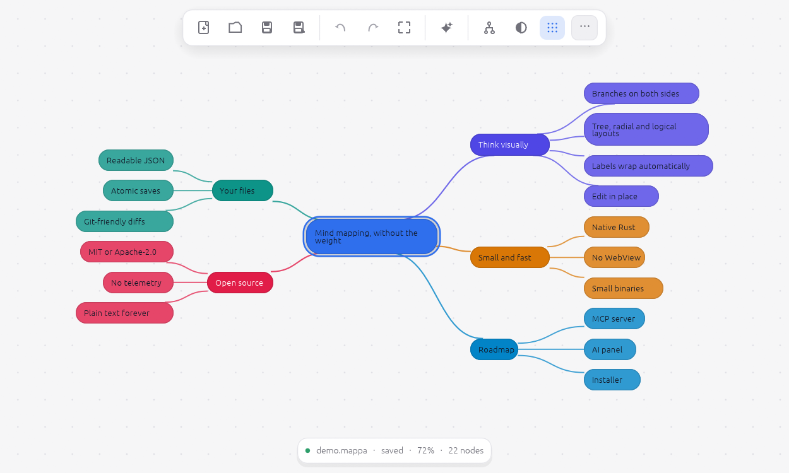

<div align="center">


# Mappamente

**Mind maps, charted.**

[](https://github.com/Marcu08/mappamente/actions/workflows/ci.yml)
[](CHANGELOG.md)
[](https://www.rust-lang.org/)
[](#license)

</div>

<p align="center">
  
</p>

Mappamente is a lightweight, open-source mind map editor written in Rust. The
name combines *mappa* (map) and *mente* (mind). It is built to stay small: a
native window, no WebView, plain JSON files you can read and diff, and a CLI
you can script. Editing, layout, themes and undo are local and instant.

> **v0.1.0:** the core engine, headless CLI and native editor are available.
> The MCP server and AI assistant are in the unreleased working tree.

## Highlights

| | |
| --- | --- |
| **Edit in place** | Double-click a node (or press `F2`), then type. `Tab` adds a child, `Enter` adds a sibling, `Delete` removes a branch. |
| **Drag to organise** | Drag a branch to move it, or drop it on another node to reparent it. Drag the background to pan. |
| **Your data** | `.mappa` is readable JSON with a schema version. Writes are atomic and validated. |
| **Interop, not lock-in** | Import Markdown outlines; export Markdown and standalone SVG with four themes. |
| **Agent-ready** | A stdio MCP server exposes reading and editing to Claude Desktop, Claude Code and other MCP clients. |
| **AI assistant** | A built-in panel edits the live canvas through OpenAI, Anthropic, OpenCode and other providers; every turn is one undo step. |
| **Small by design** | Native `egui` canvas, no WebView, no Electron, no background services. |
| **Open source** | MIT OR Apache-2.0, no telemetry, no account. |

## Quick start

### Windows shortcut (no terminal)

From the repository root:

```powershell
cargo build --release
powershell -ExecutionPolicy Bypass -File scripts/install-shortcut.ps1
```

This creates **Mappamente** on your Desktop with its own icon. Double-click it
to open the editor. The script accepts `-StartMenu` or `-Destination <folder>`
and can be re-run after `cargo clean`.

Portable launch:

```powershell
.\target\release\mappamente-desktop.exe
.\target\release\mappamente-desktop.exe docs\demo.mappa
```

The first release build takes a few minutes because eframe/egui are compiled
from source; incremental builds are much faster.

### Keyboard

| Action | Shortcut |
| --- | --- |
| Edit selected node / double-click | `F2` |
| Add child | `Tab` |
| Add sibling | `Enter` |
| Delete branch | `Delete` / `Backspace` |
| Undo / redo | `Ctrl+Z` / `Ctrl+Shift+Z` (or `Ctrl+Y`) |
| AI assistant panel | `Ctrl+Shift+A` |
| Save / save as | `Ctrl+S` / `Ctrl+Shift+S` |
| Open / new | `Ctrl+O` / `Ctrl+N` |
| Fit the map | `F` |
| Navigate | arrow keys |
| Pan / zoom | drag the background / mouse wheel |

### CLI

`mappamente.exe` is the console binary.

```powershell
# create a map
.\target\release\mappamente.exe new ideas.mappa --title "Project ideas" --root "Launch" --layout tree

# Markdown outline -> native JSON
.\target\release\mappamente.exe convert notes.md ideas.mappa

# native JSON -> Markdown outline
.\target\release\mappamente.exe convert ideas.mappa notes.md

# standalone SVG with a theme and layout override
.\target\release\mappamente.exe render ideas.mappa ideas.svg --theme light --layout tree

# open the editor
.\target\release\mappamente.exe gui ideas.mappa
```

Install it on your `PATH` with `cargo install --path crates/mappamente`, then
drop the `.\target\release\` prefix. Run `mappamente --help` for every option.
More in [docs/cli.md](docs/cli.md).

## MCP server

`mappamente-mcp` is a [Model Context Protocol](https://modelcontextprotocol.io)
server that speaks JSON-RPC over stdin/stdout. It edits the `.mappa`/`.json`
maps in a single directory and never opens a network port.

### Build

```powershell
cargo build --release -p mappamente-mcp
# binary: .\target\release\mappamente-mcp.exe

# optional: put it on PATH
cargo install --path crates/mappamente-mcp
```

### Run

```powershell
.\target\release\mappamente-mcp.exe --dir .\maps
```

`--dir` is required and must already exist. All map names are resolved inside
that directory; subdirectories, absolute paths, `..` and non-map extensions are
rejected. Diagnostics go to stderr, so stdout remains a clean MCP channel.

### Claude Desktop

Add the server to `claude_desktop_config.json`
(`%APPDATA%\Claude\` on Windows, `~/Library/Application Support/Claude/` on
macOS), then restart Claude Desktop:

```json
{
  "mcpServers": {
    "mappamente": {
      "command": "C:\\path\\to\\mappamente\\target\\release\\mappamente-mcp.exe",
      "args": ["--dir", "C:\\path\\to\\maps"]
    }
  }
}
```

### Claude Code

Register the server for the current project:

```powershell
claude mcp add mappamente -- "C:\path\to\mappamente\target\release\mappamente-mcp.exe" --dir "C:\path\to\maps"
```

The equivalent project `.mcp.json` entry is:

```json
{
  "mcpServers": {
    "mappamente": {
      "command": "C:\\path\\to\\mappamente\\target\\release\\mappamente-mcp.exe",
      "args": ["--dir", "C:\\path\\to\\maps"]
    }
  }
}
```

### Tools

| Tool | What it does |
| --- | --- |
| `list_maps` | List maps with title, node count, layout and `modified_at`. Corrupt files are reported separately. |
| `get_map` | Return metadata plus an indented outline whose lines start with node ids. |
| `create_map` | Create a map; never overwrites an existing file. |
| `add_node` | Add a child below an existing node, optionally at an index. |
| `add_subtree_from_markdown` | Parse a Markdown outline and insert its bullets as a subtree. |
| `update_node` | Change text, note, color and/or collapsed state. |
| `move_node` | Reparent a branch, rejecting cycles and root moves. |
| `delete_node` | Delete a node and its whole subtree; the root is protected. |
| `set_layout` | Set `radial`, `logical` or `tree` (bilateral). |
| `export` | Write `svg`, `markdown` or native `mappa` output next to the map. |

Read tools return `modified_at`; pass it back as `expected_modified_at` on any
mutation to get an `isError` result instead of overwriting a concurrent change.
Omitting the token means last write wins. Text and notes are limited to 10,000
characters, Markdown input to 100,000 characters, and map files to 5 MiB.

### Security

- **No network:** the server is launched by the MCP client and only uses stdin,
  stdout and the filesystem. It also sends no telemetry.
- **Sandboxed names:** map names must be simple file names with `.mappa` or
  `.json`; existing paths are canonicalized and must stay below `--dir`, so
  symlinks and traversal attempts outside the directory are rejected.
- **Explicit overwrites:** `create_map` never replaces a file, and `export`
  requires `overwrite: true`; native export refuses to overwrite its source.
- **Crash-safe writes:** every save goes through the core atomic writer
  (temporary file, sync, rename).
- **Least privilege:** point `--dir` at a maps folder, not at your home
  directory; any MCP client you connect can edit every map inside it.

## AI assistant

Click **AI** in the toolbar to open the assistant panel. Ask it to create a
branch, reorganise the map, rename nodes or summarise the current structure.
The current map is sent as an outline with stable node ids; the model returns a
short reply and a JSON list of actions. The app applies the whole list as one
undoable transaction and repaints the canvas immediately, so **Ctrl+Z** undoes
the entire AI turn.

The response is applied when it is complete; there is no token-by-token
streaming yet. A turn can add nodes and subtrees, update text/notes/colors/
collapsed state, move or delete branches, and change layout, title or theme.

### Providers

Select a provider, model and base URL in the panel. API keys are saved in the
OS credential store (Windows Credential Manager, macOS Keychain or Secret
Service) and can be overridden by the environment variable shown below.

| Provider | Key | Notes |
| --- | --- | --- |
| OpenAI | `OPENAI_API_KEY` | OpenAI chat completions. |
| Anthropic | `ANTHROPIC_API_KEY` | Anthropic Messages API. |
| OpenCode Console | `OPENCODE_API_KEY` | OpenCode Zen/Console cloud gateway. |
| OpenCode local | `OPENCODE_PASSWORD` | Local `opencode serve`, optional model as `provider/model`. |
| OpenRouter | `OPENROUTER_API_KEY` | Model router. |
| Groq | `GROQ_API_KEY` | Fast inference. |
| DeepSeek | `DEEPSEEK_API_KEY` | DeepSeek API. |
| Mistral | `MISTRAL_API_KEY` | Mistral API. |
| Google Gemini | `GEMINI_API_KEY` | Gemini OpenAI-compatible endpoint. |
| xAI | `XAI_API_KEY` | Grok API. |
| Ollama | — | Local, no key; default `http://localhost:11434/v1`. |
| LM Studio | — | Local, no key; default `http://127.0.0.1:1234/v1`. |
| Custom / local | `MAPPAMENTE_API_KEY` | Any OpenAI-compatible endpoint. |

For a local OpenCode server:

```powershell
opencode serve --port 4096
```

Select **OpenCode local**, keep `http://localhost:4096`, optionally enter a
model in `provider/model` form, and store `OPENCODE_PASSWORD` (or
`OPENCODE_SERVER_PASSWORD`) as the key if the server uses Basic authentication.
The adapter calls OpenCode's one-shot `/api/experimental/generate/text` endpoint,
so it uses the server's configured providers and models.

### Privacy and limits

- **On demand:** the panel only contacts the provider you select when you send
  a message. There is no telemetry or background network traffic.
- **Map contents leave the app:** the current map outline is sent to that
  provider. Remote endpoints must use HTTPS; plain `http` is accepted only for
  localhost/loopback addresses.
- **No secrets in files:** keys live in the OS keyring or environment, never in
  `.mappa` files or logs.
- **Context limit:** maps whose outline exceeds 120,000 characters are refused
  rather than truncated silently. Text/notes are capped at 10,000 characters.
- **Undo:** one AI turn is one undo step. Manual positions and cross-links are
  not exposed by the action protocol yet.

## What works today

- **Editor:** inline labels, add/delete nodes, sibling ordering, drag to move or
  reparent, pan/zoom/fit, layout and theme switching, undo/redo, save and save
  as, open dialog, drag & drop, unsaved-change guard.
- **Documents:** tree model, short stable IDs, notes, colors, collapsed
  branches, manual positions, validation, forward-compatible JSON.
- **Layouts:** bilateral tree, radial and logical; wrapped labels with Unicode
  widths; deterministic output; no overlaps.
- **CLI:** `new`, `convert`, `render`, `gui`.
- **MCP:** stdio server with sandboxed map access, ten tools, optimistic
  concurrency and tool-level errors.
- **AI:** side panel with OpenAI, Anthropic, OpenCode Console/local, OpenRouter,
  Groq, DeepSeek, Mistral, Gemini, xAI, Ollama, LM Studio and custom endpoints;
  OS keyring storage; live JSON actions in one undo step.
- **Formats:** native `.mappa`/`.json`, Markdown outlines, SVG.
- **Engineering:** 146 tests, CI for Linux/Windows/macOS, `clippy -D warnings`,
  rustdoc clean, dual license.

Not implemented yet: autosave, node notes/colors UI, collapse toggle in the
canvas, OPML/FreeMind, PNG/PDF, MCP live reload and provider-native tool calling.
See the [roadmap](#roadmap).

## File format

`.mappa` is UTF-8 JSON with a version, stable field order and a trailing
newline:

```json
{
  "version": 1,
  "id": "m_pd289a2w",
  "title": "Project ideas",
  "theme": "light",
  "layout": "tree",
  "created_at": 1795594643981,
  "modified_at": 1795594643981,
  "root": {
    "id": "n_gq596zks",
    "text": "Launch",
    "children": [
      { "id": "n_2qb1123j", "text": "First branch", "children": [] }
    ]
  }
}
```

Writes go to a temporary file, are synced, then renamed over the target. Read
[docs/file-format.md](docs/file-format.md) for every field and invariant.

Why JSON and not XML? Internally XML would add verbosity and parsing overhead
without any structural benefit. XML remains an **interop** format at the edges
(OPML and FreeMind, planned); Markdown and SVG are already implemented.

## Architecture

```
crates/
  mappamente-core/     no GUI dependencies
    model.rs           document tree, IDs, validation, operations
    layout.rs          tree / radial / logical layout, text wrapping
    history.rs         snapshot undo/redo, transactions, coalescing
    io/                native JSON + Markdown, atomic writes, migration
    export/svg.rs      deterministic SVG renderer
    theme.rs           four shared palettes
  mappamente/          lib + two binaries
    cli.rs             new | convert | render | gui
    gui.rs             editing canvas (eframe)
    ai_panel.rs        AI side panel, worker thread and chat
    bin/mappamente     console CLI
    bin/mappamente-desktop  GUI-subsystem launcher for double-click
  mappamente-mcp/      stdio MCP server
    store.rs           sandboxed map directory, mutations, export
    server.rs          rmcp tools and server metadata
    main.rs            --dir parsing, stdio transport
  mappamente-ai/       AI provider layer (no GUI)
    provider.rs        provider presets and protocols
    client.rs          OpenAI-compatible, Anthropic and OpenCode local clients
    action.rs          JSON edit actions and transactional application
    prompt.rs          system prompt and map context
    credential.rs      OS keyring with environment fallback
scripts/                shortcut installer
assets/                 application icon and shortcut icon
docs/                   demo map, format and CLI docs, screenshots
```

The core owns layout and persistence, so the editor, the SVG exporter and the
MCP server all agree on geometry, colors and serialization. The console and
desktop binaries share the same library; the desktop one has no console window
on Windows release builds.

The MCP server is a separate binary that writes files atomically; a future file
watcher will let the GUI reload external changes. The AI panel uses
`mappamente-ai` to call the selected provider and applies the returned action
plan through the same `Editor`, so the canvas, undo history and dirty tracking
stay consistent.

## Roadmap

| Milestone | Scope | Status |
| --- | --- | --- |
| 1 | Core model, JSON, layout, undo, CI, licenses | Done |
| 2 | CLI, Markdown, SVG, preview window, shortcut | Done |
| 3 | Editing canvas: inline edit, add/delete, drag/reparent, save, undo | Done |
| 4 | OPML / FreeMind, PNG export, autosave | Planned |
| 5 | MCP server, live reload, client setup | MCP server done; live reload planned |
| 6 | AI panel with provider selection, keyring and live edits | Done |
| 7 | Installer, file associations, packaging | Planned |

## Development

```bash
cargo test --all
cargo clippy --all-targets --all-features -- -D warnings
cargo fmt --all -- --check
```

Demo assets are reproducible:

```powershell
.\target\release\mappamente.exe convert docs\demo.md docs\demo.mappa --theme light --layout tree --force
.\target\release\mappamente.exe render docs\demo.mappa docs\screenshot.svg --force
```

Contributions are welcome. Keep changes focused, add tests for behaviour, and
run the three commands above before opening a pull request.

## License

Licensed under either of

- Apache License, Version 2.0 ([LICENSE-APACHE](LICENSE-APACHE))
- MIT license ([LICENSE-MIT](LICENSE-MIT))

at your option. Unless you explicitly state otherwise, any contribution
intentionally submitted for inclusion in this project by you, as defined in the
Apache-2.0 license, shall be dual licensed as above, without any additional
terms or conditions.
